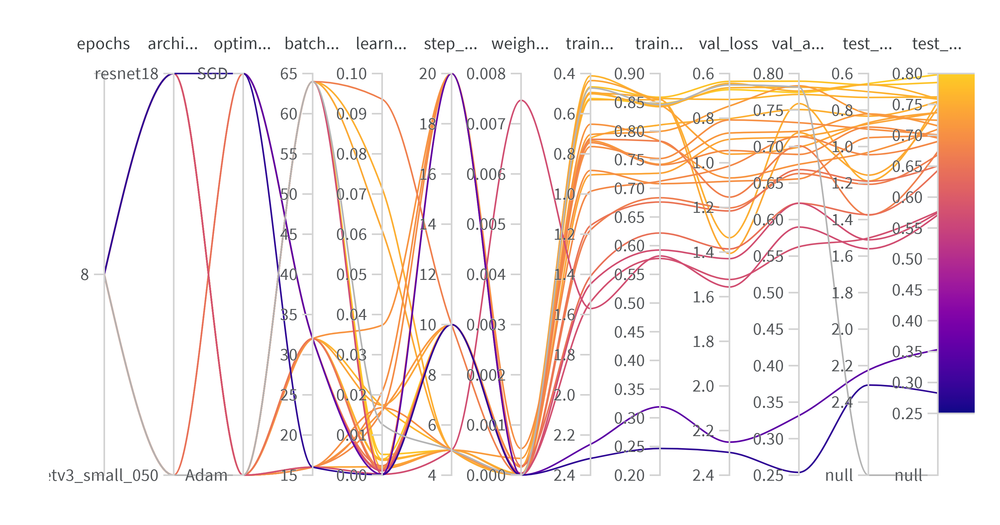

# Exam template for 02476 Machine Learning Operations


This is the report template for the exam. Please only remove the text formatted as with three dashes in front and behind
like:


```--- question 1 fill here ---```


Where you instead should add your answers. Any other changes may have unwanted consequences when your report is
auto-generated at the end of the course. For questions where you are asked to include images, start by adding the image
to the `figures` subfolder (please only use `.png`, `.jpg` or `.jpeg`) and then add the following code in your answer:


```markdown

```


In addition to this markdown file, we also provide the `report.py` script that provides two utility functions:


Running:


```bash
python report.py html
```


Will generate a `.html` page of your report. After the deadline for answering this template, we will auto-scrape
everything in this `reports` folder and then use this utility to generate a `.html` page that will be your serve
as your final hand-in.


Running


```bash
python report.py check
```


Will check your answers in this template against the constraints listed for each question e.g. is your answer too
short, too long, or have you included an image when asked. For both functions to work you mustn't rename anything.
The script has two dependencies that can be installed with


```bash
pip install typer markdown
```


## Overall project checklist


The checklist is *exhaustive* which means that it includes everything that you could do on the project included in the
curriculum in this course. Therefore, we do not expect at all that you have checked all boxes at the end of the project.
The parenthesis at the end indicates what module the bullet point is related to. Please be honest in your answers, we
will check the repositories and the code to verify your answers.


### Week 1


* [x] Create a git repository (M5)
* [x] Make sure that all team members have write access to the GitHub repository (M5)
* [x] Create a dedicated environment for you project to keep track of your packages (M2)
* [x] Create the initial file structure using cookiecutter with an appropriate template (M6)
* [x] Fill out the `data.py` file such that it downloads whatever data you need and preprocesses it (if necessary) (M6)
* [x] Add a model to `model.py` and a training procedure to `train.py` and get that running (M6)
* [x] Remember to fill out the `requirements.txt` and `requirements_dev.txt` file with whatever dependencies that you
    are using (M2+M6)
* [x] Remember to comply with good coding practices (`pep8`) while doing the project (M7)
* [x] Do a bit of code typing and remember to document essential parts of your code (M7)
* [x] Setup version control for your data or part of your data (M8)
* [x] Add command line interfaces and project commands to your code where it makes sense (M9)
* [x] Construct one or multiple docker files for your code (M10)
* [x] Build the docker files locally and make sure they work as intended (M10)
* [x] Write one or multiple configurations files for your experiments (M11)
* [x] Used Hydra to load the configurations and manage your hyperparameters (M11)
* [ ] Use profiling to optimize your code (M12)
* [x] Use logging to log important events in your code (M14)
* [x] Use Weights & Biases to log training progress and other important metrics/artifacts in your code (M14)
* [x] Consider running a hyperparameter optimization sweep (M14)
* [ ] Use PyTorch-lightning (if applicable) to reduce the amount of boilerplate in your code (M15)


### Week 2


* [x] Write unit tests related to the data part of your code (M16)
* [x] Write unit tests related to model construction and or model training (M16)
* [x] Calculate the code coverage (M16)
* [x] Get some continuous integration running on the GitHub repository (M17)
* [x] Add caching and multi-os/python/pytorch testing to your continuous integration (M17)
* [x] Add a linting step to your continuous integration (M17)
* [x] Add pre-commit hooks to your version control setup (M18)
* [ ] Add a continues workflow that triggers when data changes (M19)
* [x] Add a continues workflow that triggers when changes to the model registry is made (M19)
* [ ] Create a data storage in GCP Bucket for your data and link this with your data version control setup (M21)
* [x] Create a trigger workflow for automatically building your docker images (M21)
* [x] Get your model training in GCP using either the Engine or Vertex AI (M21)
* [x] Create a FastAPI application that can do inference using your model (M22)
* [x] Deploy your model in GCP using either Functions or Run as the backend (M23)
* [x] Write API tests for your application and setup continues integration for these (M24)
* [x] Load test your application (M24)
* [ ] Create a more specialized ML-deployment API using either ONNX or BentoML, or both (M25)
* [ ] Create a frontend for your API (M26)


### Week 3


* [x] Check how robust your model is towards data drifting (M27)
* [ ] Deploy to the cloud a drift detection API (M27)
* [x] Instrument your API with a couple of system metrics (M28)
* [ ] Setup cloud monitoring of your instrumented application (M28)
* [x] Create one or more alert systems in GCP to alert you if your app is not behaving correctly (M28)
* [ ] If applicable, optimize the performance of your data loading using distributed data loading (M29)
* [ ] If applicable, optimize the performance of your training pipeline by using distributed training (M30)
* [ ] Play around with quantization, compilation and pruning for you trained models to increase inference speed (M31)


### Extra


* [ ] Write some documentation for your application (M32)
* [ ] Publish the documentation to GitHub Pages (M32)
* [x] Revisit your initial project description. Did the project turn out as you wanted?
* [x ] Create an architectural diagram over your MLOps pipeline
* [x] Make sure all group members have an understanding about all parts of the project
* [x] Uploaded all your code to GitHub


## Group information


### Question 1
> **Enter the group number you signed up on <learn.inside.dtu.dk>**
>
> Answer:


14


### Question 2
> **Enter the study number for each member in the group**
>
> Example:
>
> *sXXXXXX, sXXXXXX, sXXXXXX*
>
> Answer:


s241645, s242766, s232735, s204225, s204218


### Question 3
> **A requirement to the project is that you include a third-party package not covered in the course. What framework**
> **did you choose to work with and did it help you complete the project?**
>
> Recommended answer length: 100-200 words.
>
> Example:
> *We used the third-party framework ... in our project. We used functionality ... and functionality ... from the*
> *package to do ... and ... in our project*.
>
> Answer:


We used the third-party framework PyTorch Image Models (TIMM) in our project. We primarily used the "create_model" function to easily get a pre-trained model which we could transfer learn on our dataset. We chose to go with a smaller mobilenet_v3_050 model and a somewhat larger (but still relatively small so everything could be run locally on everyones computer) resnet18 model. We tried the resnet50 model, but one of our group members computer crashed when trying to run the train.py script. This was an easy way to get some different image models which we could compare with our own simple CNN.


## Coding environment


> In the following section we are interested in learning more about you local development environment. This includes
> how you managed dependencies, the structure of your code and how you managed code quality.


### Question 4


> **Explain how you managed dependencies in your project? Explain the process a new team member would have to go**
> **through to get an exact copy of your environment.**
>
> Recommended answer length: 100-200 words
>
> Example:
> *We used ... for managing our dependencies. The list of dependencies was auto-generated using ... . To get a*
> *complete copy of our development environment, one would have to run the following commands*
>
> Answer:


We started with a requirements file that was basically the same as the course (maybe with extra packages). But as we came closer to the end of the project we decided to run pipreq to shorten the large list. To get a complete copy of our environment, a new member must run:
pip install -r requirements.txt,
pip install -r requirements_dev.
pip install -e .
These 3 are also executed with invoke requirements.


To also get the data, a member must add a config.local file in the .dvc folder and run
dvc pull
and accept all authentication steps. Someone outside of the project would have to download the data from kaggle (see the README file at root)


### Question 5


> **We expect that you initialized your project using the cookiecutter template. Explain the overall structure of your**
> **code. What did you fill out? Did you deviate from the template in some way?**
>
> Recommended answer length: 100-200 words
>
> Example:
> *From the cookiecutter template we have filled out the ... , ... and ... folder. We have removed the ... folder*
> *because we did not use any ... in our project. We have added an ... folder that contains ... for running our*
> *experiments.*
>
> Answer:


From the cookiecutter template we have filled out the .github, configs, data, dockerfiles, (docs), models, reports, src, tests folder. We have removed the notebooks (and docs) folder, since we didn't use any noteboooks. We have added a .dvc folder, so we can utilize the functionalities from dvc. We had credentials like a .env for the Wandb api key in the root of the project folder but these were added to .gitignore for security reasons. But we have mostly stayed with the cookiecutter template in order to not break any of the file path dependencies. But as a tool to add structure to a project, cookiecutter is definitely a nice-to-have.


### Question 6


> **Did you implement any rules for code quality and format? What about typing and documentation? Additionally,**
> **explain with your own words why these concepts matters in larger projects.**
>
> Recommended answer length: 100-200 words.
>
> Example:
> *We used ... for linting and ... for formatting. We also used ... for typing and ... for documentation. These*
> *concepts are important in larger projects because ... . For example, typing ...*
>
> Answer:


We used ruff for linting and to conform to pep8. Ruff was also a part of our pre-commit and used in github actions to enforce it. We also used the in-built python type hints for typing to the best of our abilities, but we did not enforce it via external packages or in the github actions workflow. The code was documented to the best of our abilities through comments which we crafted ourselves, but github copilot did come in handy there as it sped up the process. Most methods and functions also used doc strings to simply explain the purpose of the methods.

These concepts are important in larger projects because it streamlines the code, and makes it more readable for other users. It also has the advantage that it makes the code easier to come back to and understand if one have been away from it for a year or more. Especially in larger projects, where multiple scripts communicate with each other and everything simply becomes more complex, the above mentioned concepts are almost a necessity, unless one enjoys time wasting and general chaos.


## Version control


> In the following section we are interested in how version control was used in your project during development to
> corporate and increase the quality of your code.


### Question 7


> **How many tests did you implement and what are they testing in your code?**
>
> Recommended answer length: 50-100 words.
>
> Example:
> *In total we have implemented X tests. Primarily we are testing ... and ... as these the most critical parts of our*
> *application but also ... .*
>
> Answer:


In total we have implemented  8 test functions. 6 of these are api tests, 1 is a model test and 1 is a data test. The most important api test, are those that test the predict "method" returns the expected json format. The model test simply tests if the output is of the expected size. The data test tests for the size and shape of the dataset, the number of classes and that every class is represented.

Additionally we created performance tests with locust to load test our api. There were in total 5 defined performance test functions.


### Question 8


> **What is the total code coverage (in percentage) of your code? If your code had a code coverage of 100% (or close**
> **to), would you still trust it to be error free? Explain you reasoning.**
>
> Recommended answer length: 100-200 words.
>
> Example:
> *The total code coverage of code is X%, which includes all our source code. We are far from 100% coverage of our **
> *code and even if we were then...*
>
> Answer:


The total code coverage of tested code is 73%, which include the most important source code (api, data, model). For the api and model we are over 90%, but for the data we are only at 22%. This is mostly due to the fact that we have written new functions for the data file, which we haven’t written tests to. The most essential functions are tested. But even if we got 100% code coverage, there is no guarantee that the code is error free. This is because we can’t write tests on every edge-case, and some of these might make the code break. But with a high code coverage, one can at least feel a little bit safer.


### Question 9


> **Did you workflow include using branches and pull requests? If yes, explain how. If not, explain how branches and**
> **pull request can help improve version control.**
>
> Recommended answer length: 100-200 words.
>
> Example:
> *We made use of both branches and PRs in our project. In our group, each member had an branch that they worked on in*
> *addition to the main branch. To merge code we ...*
>
> Answer:


We made use of both branches and PRs in our project. No one had their own branch, but made a branch and named it according to what feature they were implementing. In hindsight, dedicating one branch to each member might have been a smart move, to reduce the amount of "i forgot to delete my branch after a successfull PR". After we did a PR, we typically (if it was a larger or more important PR) send a message in slack describing what changes we have done, and if anyone should be aware of some of these changes (eg. some of the code now depends on the tests completing, so if your code doesn't complete the tests, something have probably been broken).


### Question 10


> **Did you use DVC for managing data in your project? If yes, then how did it improve your project to have version**
> **control of your data. If no, explain a case where it would be beneficial to have version control of your data.**
>
> Recommended answer length: 100-200 words.
>
> Example:
> *We did make use of DVC in the following way: ... . In the end it helped us in ... for controlling ... part of our*
> *pipeline*
>
> Answer:


We did make use of the DVC in our project. We used it with the aim to version control our data, however the raw dataset was never changed, so we never had to revert to an earlier version of the dataset or create new versions of it. The dataset essentially only has two major versions: the dataset only containing the original raw data, and the dataset containing the raw data and the preprocessed data. This did however help us in the sense that we could easily share the dataset between group members, and we could easily download the dataset from the cloud to our local machine.


### Question 11


> **Discuss you continuous integration setup. What kind of continuous integration are you running (unittesting,**
> **linting, etc.)? Do you test multiple operating systems, Python  version etc. Do you make use of caching? Feel free**
> **to insert a link to one of your GitHub actions workflow.**
>
> Recommended answer length: 200-300 words.
>
> Example:
> *We have organized our continuous integration into 3 separate files: one for doing ..., one for running ... testing*
> *and one for running ... . In particular for our ..., we used ... .An example of a triggered workflow can be seen*
> *here: <weblink>*
>
> Answer:


We do multiple continuous integration. We do unit-testing, build and push docker images, run load test on deployed model using locust, codechecking via ruff, and model testing. All tests are done on ubuntu, except the unit-testing which is done on ubuntu, windows and mac operating systems. The unit-testing also runs on two python versions, namely 3.11 and 3.12. Whenever we need to install dependencies, we use caching to speed things up. Here is a link to the model testing workflow: https://github.com/arnormoncada/mlops-plant-seedlings/blob/main/.github/workflows/stage_model.yaml. We have organized the continous integrations into their own seperate file for easy overview and handeling. Although most of the tests only run on ubuntu and one version of Python, the tests take a while to complete. This can be very annoying although they make it harder for the pushed code to fail, so in the end the waiting time is not that bad considering the consequences there can be without them. 

Although we have what some would say were a lot of workflows, we could definately have added more, for instance a workflow that does the data drifting automatically if data is added somewhere in the process. This could ensure early on that our model's data input stays within expected margins.


## Running code and tracking experiments


> In the following section we are interested in learning more about the experimental setup for running your code and
> especially the reproducibility of your experiments.


### Question 12


> **How did you configure experiments? Did you make use of config files? Explain with coding examples of how you would**
> **run a experiment.**
>
> Recommended answer length: 50-100 words.
>
> Example:
> *We used a simple argparser, that worked in the following way: Python  my_script.py --lr 1e-3 --batch_size 25*
>
> Answer:


We made use of config files. The main config file "config.yaml" was used to specify optimizer, model etc.. Then, we had separate config files for each of these to specify the hyperparameters such as learning rate and batch size. In our project we only made use of the adam optimizer, but the setup works to handle multiple selections of optimizer as well. Before running an experiment, one had to set up the experiment by changing parameters through these config files, thus no arguments were passed.


### Question 13


> **Reproducibility of experiments are important. Related to the last question, how did you secure that no information**
> **is lost when running experiments and that your experiments are reproducible?**
>
> Recommended answer length: 100-200 words.
>
> Example:
> *We made use of config files. Whenever an experiment is run the following happens: ... . To reproduce an experiment*
> *one would have to do ...*
>
> Answer:


We made use of config files via Hydra. Whenever an experiment is run, multiple print statements are run, which prints the contents of the config files, so that you early on can catch if that indeed was the experiment you intended to run. We also used seeding to make the training as reproducible as possible. In addition to this, all configurations were saved as satellite data, thus visible in weights and biases. Also, all final models were saved as artefacts on wandb to ensure reproducibility. As we don't use any randomization, we haven't set a seed, but regardless it can be a good idea to set one, just in case.


### Question 14


> **Upload 1 to 3 screenshots that show the experiments that you have done in W&B (or another experiment tracking**
> **service of your choice). This may include loss graphs, logged images, hyperparameter sweeps etc. You can take**
> **inspiration from [this figure](figures/wandb.png). Explain what metrics you are tracking and why they are**
> **important.**
>
> Recommended answer length: 200-300 words + 1 to 3 screenshots.
>
> Example:
> *As seen in the first image when have tracked ... and ... which both inform us about ... in our experiments.*
> *As seen in the second image we are also tracking ... and ...*
>
> Answer:
We used wandbs’ sweep feature to tune hyperparameters with the bayesian method. To configure the sweep we used a sweep_config.yaml to maximize validation accuracy. The tunable parameters were model type, optimizer type, learning rate, momentum, weight decay, step size and batch size.


Our sweep followed a pipeline consisting of a sweep where loss, accuracy for the train, test, validation sets and interference time was logged. After training and evaluation the model was saved in a GCP bucket. We limit the amount of runs by defining the run count in the wand agent.


The chosen metrics loss, accuracy and interference time are important in our case as our problem is a classification task you are either right or wrong so accuracy is a great way of measuring performance. Our model should also be able to run fast to be useful for any agriculture application so logging interference time is also important, with these metrics as context we can choose the best model.


Here below you can see the results of our wandb sweeps they are really cool. It might be hard to see which exact model is performing great, but that is easier to see in the wandb webpage.
```markdown

```


### Question 15


> **Docker is an important tool for creating containerized applications. Explain how you used docker in your**
> **experiments/project? Include how you would run your docker images and include a link to one of your docker files.**
>
> Recommended answer length: 100-200 words.
>
> Example:
> *For our project we developed several images: one for training, inference and deployment. For example to run the*
> *training docker image: `docker run trainer:latest lr=1e-3 batch_size=64`. Link to docker file: <weblink>*
>
> Answer:


We created two separate docker images, one for training and one for the api. Though the training docker image was not used as much, but it still was created for reproducibility purposes.


The api docker image was crucial for this project as it was easy to run the service locally through it, but also it was an integral part in our continuous cloud build pipeline. Where the api was containerized, built, pushed to the cloud artifact registry and then deployed.


The api image was also built and pushed to docker hub as a part of our github actions workflows:


https://hub.docker.com/r/arnormoncada/api

You can pull one of the images from the tags tab e.g.

docker pull arnormoncada/api:97ec88f5beb75b8e33d5a77e59acce45d298ee30


and then run it locally with:


docker run -p 8000:8000 -e PORT=8000 arnormoncada/api:97ec88f5beb75b8e33d5a77e59acce45d298ee30


### Question 16


> **When running into bugs while trying to run your experiments, how did you perform debugging? Additionally, did you**
> **try to profile your code or do you think it is already perfect?**
>
> Recommended answer length: 100-200 words.
>
> Example:
> *Debugging method was dependent on group member. Some just used ... and others used ... . We did a single profiling*
> *run of our main code at some point that showed ...*
>
> Answer:


The type of debugging used was very dependent on both the group member and the type of error as the easiest solution often tends to differ. We used both ad-hoc print statements for showing temporary results while running, vs-code debugger for more in-depth analysis (such as shapes or types) and occasional profiling for timeouts etc.. Additionally we made use of visual inspection of image results when applicable. 
One example of useful use of visual inspection and direct data investigation was when we at a point experienced different performance in the api against the actual evaluation (it turned out that the images were handled slightly differently, resulting in misclassifications). 


## Working in the cloud


> In the following section we would like to know more about your experience when developing in the cloud.


### Question 17


> **List all the GCP services that you made use of in your project and shortly explain what each service does?**
>
> Recommended answer length: 50-200 words.
>
> Example:
> *We used the following two services: Engine and Bucket. Engine is used for... and Bucket is used for...*
>
> Answer:


APIs & Services: Manages API access and integrations for Google Cloud Services.
IAM & Admin: Identity and access management for cloud projects. Management of permissions, roles and access control for cloud resources.
Cloud Run: Platform to run and scale containerized applications.
Artifact Registry: A service/place to store and manage artifacts e.g. docker images used for deployment. 
Cloud Build: A platform for executing automated build pipelines, allowing you to build and deploy images. Monitoring: A out of the box platform for metric collection and dashboards. Where you can monitor the performance and health of your deployed services and set alerts.
Bucket: A basic data storage container, usually used for storing things like files and multimedia files. 
Compute Engine: Hosting service which lets you create and use VMs on the google cloud infrastructure with customizable hardware and configs. Easily scalable also.


### Question 18


> **The backbone of GCP is the Compute engine. Explained how you made use of this service and what type of VMs**
> **you used?**
>
> Recommended answer length: 100-200 words.
>(Talk about VM why not vertexAI, what GPU)
> Example:
> *We used the compute engine to run our ... . We used instances with the following hardware: ... and we started the*
> *using a custom container: ...*
>
> Answer:


We used a VM instance with a Nvidia T4 GPU with a machine type n1-standard to run training
One of our GCP buckets contains every trained model. This way we could train models without cluttering up the github or our local machine and still share access to every model with team members. The premise behind this idea is we could see the best performing model on Wandb and then find it in the bucket as it has the same run name then deploy that. We found this method to work very nicely, and is definately something we intend to use in future projects if applicable.


### Question 19


> **Insert 1-2 images of your GCP bucket, such that we can see what data you have stored in it.**
> **You can take inspiration from [this figure](figures/bucket.png).**
>
> Answer: 
Here below is the GCP bucket of all our trained models
(image of GCP bucket of models)


(Image of API GCP bucket)


### Question 20


> **Upload 1-2 images of your GCP artifact registry, such that we can see the different docker images that you have**
> **stored. You can take inspiration from [this figure](figures/registry.png).**
>
> Answer:


Arnór will provide picture


### Question 21


> **Upload 1-2 images of your GCP cloud build history, so we can see the history of the images that have been build in**
> **your project. You can take inspiration from [this figure](figures/build.png).**
>
> Answer:


Arnór will provide pocture


### Question 22


> **Did you manage to train your model in the cloud using either the Engine or Vertex AI? If yes, explain how you did**
> **it. If not, describe why.**
>
> Recommended answer length: 100-200 words.
>
> Example:
> *We managed to train our model in the cloud using the Engine. We did this by ... . The reason we choose the Engine*
> *was because ...*
>
> Answer:
Our first venture was to use VertexAI to do model training and hyperparameters sweeps, logging and saving models in the artifact registry, an ambitious task and it was too ambitious. We ran into problems integrating our code into a format vertexAI can work with and the course timeline was too tight to solve the issue we decided to pivot and use a VM instance to do model training. But once again we landed in internet difficulties copying the data over to the VM instance after 4 hours the data was still downloading into the VM instance. Thankfully one team member had a nvidia card that was cuda capable gtx 3060 and we did the sweep with that.
--- question 22 fill here ---


## Deployment


### Question 23


> **Did you manage to write an API for your model? If yes, explain how you did it and if you did anything special. If**
> **not, explain how you would do it.**
>
> Recommended answer length: 100-200 words.
>
> Example:
> *We did manage to write an API for our model. We used FastAPI to do this. We did this by ... . We also added ...*
> *to the API to make it more ...*
>
> Answer:


Yes we created an API using the FastAPI framework. The api has a total of three endpoints:

GET /
GET /models
POST /predict

The get models endpoint returns the available models for the service. The post predict endpoint allows a user to select their model for inference and upload an image of a plant seedling and get a prediction.

The model loads in the three available models and their weights from selected "best" training runs on startup.

The most important endpoint is the /predict. It has query parameter enum where for the user to pick one of the available models for the inference. It then has some basic input validations on the type of files uploaded and responds with a 400 if a wrong filetype is uploaded.

It is also integrated with prometheus for some basic metrics.
https://plant-seedlings-api-1034288317994.europe-west1.run.app/metrics/

The OAS swagger is available at:
https://plant-seedlings-api-1034288317994.europe-west1.run.app/docs


### Question 24


> **Did you manage to deploy your API, either in locally or cloud? If not, describe why. If yes, describe how and**
> **preferably how you invoke your deployed service?**
>
> Recommended answer length: 100-200 words.
>
> Example:
> *For deployment we wrapped our model into application using ... . We first tried locally serving the model, which*
> *worked. Afterwards we deployed it in the cloud, using ... . To invoke the service an user would call*
> *`curl -X POST -F "file=@file.json"<weburl>`*
>
> Answer:
Yes, the api was first developed and "deployed" locally, and then a cloudbuild.yaml was defined to build the api image, upload it to the artifact registry and then deploy the service using cloudbuild.

The github repository was then connected to the cloud run service for continuous deployment. Meaning whenever changes were pushed on main, the service was built and redeployed using the before mentioned cloudbuild.yaml.


Here is the url to the service. I would recommend using the OAS swagger ( /docs ) to try out the endpoints. Easier that way when it comes to uploading files. The swagger also provides example curl commands if preferred.
https://plant-seedlings-api-1034288317994.europe-west1.run.app/


### Question 25


> **Did you perform any unit testing and load testing of your API? If yes, explain how you did it and what results for**
> **the load testing did you get. If not, explain how you would do it.**
>
> Recommended answer length: 100-200 words.
>
> Example:
> *For unit testing we used ... and for load testing we used ... . The results of the load testing showed that ...*
> *before the service crashed.*
>
> Answer:


Yes, we wrote integration tests and performance tests for the api. 


The performance tests were creating using locust. Each endpoint was load tested with specific weights. With the predict endpoint having the highest weight and three separate tests for each available model, since this is the most important endpoint. The performance tests were also added to github actions as a separate workflow which triggers on merges to main and stores the results as an artifact., It does the performance test on the api deployed to google cloud. An example result can be seen here (ARNÓR PROVIDE HTML TABLE FILE)


Basic Integration tests were added to test the endpoints. The aim was to make test what could be considered deterministic for the api, i.e. the status codes and response schemas. This was also a part of github actions.


### Question 26


> **Did you manage to implement monitoring of your deployed model? If yes, explain how it works. If not, explain how**
> **monitoring would help the longevity of your application.**
>
> Recommended answer length: 100-200 words.
>
> Example:
> *We did not manage to implement monitoring. We would like to have monitoring implemented such that over time we could*
> *measure ... and ... that would inform us about this ... behaviour of our application.*
>
> Answer:


Yes we were able to implement some monitoring for the api. We instrumented our API with prometheus. We defined the following metrics to be stored:

error_counter = Counter("errors", "Number of errors", ["endpoint", "status_code"], registry=MY_REGISTRY)
request_counter = Counter("requests", "Number of requests", ["endpoint", "status_code"], registry=MY_REGISTRY)
request_latency = Histogram("request_latency_seconds", "Request latency", ["endpoint"], registry=MY_REGISTRY)
plant_image_size = Summary("plant_image_size", "Size of the plant image inputs", registry=MY_REGISTRY)


As can be seen an error counter and request counter was defined. Also the how long it took for requests to finish for the endpoints, and the total image size of uploaded media to the api.


These metrics are then accessable at: https://plant-seedlings-api-1034288317994.europe-west1.run.app/metrics/


We were not able to setup cloud monitoring for these instrumented metrics with the sidecar and/or kuberentes approach as it clashed with our current continuous deployment setup, and we would’ve had to change a number of things too late in the course.


We did however create some system alerts for if the API is not behaving as expected. Such as if the number of 500 errors exceeded some threshold or if the latency of requests is too high. It would then alert us through email.


## Overall discussion of project


> In the following section we would like you to think about the general structure of your project.


### Question 27


> **How many credits did you end up using during the project and what service was most expensive? In general what do**
> **you think about working in the cloud?**
>
> Recommended answer length: 100-200 words.
>
> Example:
> *Group member 1 used ..., Group member 2 used ..., in total ... credits was spend during development. The service*
> *costing the most was ... due to ... . Working in the cloud was ...*
>
> Answer:


Not all group members were using the cloud, as we didn't do much training on the cloud. In reality we didn't end up using many rescources regardless in the cloud. We have ended up using around 2$, so really not that much.


### Question 28


> **Did you implement anything extra in your project that is not covered by other questions? Maybe you implemented**
> **a frontend for your API, use extra version control features, a drift detection service, a kubernetes cluster etc.**
> **If yes, explain what you did and why.**
>
> Recommended answer length: 0-200 words.
>
> Example:
> *We implemented a frontend for our API. We did this because we wanted to show the user ... . The frontend was*
> *implemented using ...*
>
> Answer:


We implemented drift detection, but didn’t get it to run on the cloud. Since our dataset comprised of images, we
first had to extract image features from our dataset and save it in a csv file. We went with the simple script available in M27, where we extracted sharpness, brightness and contrast. When this was done, we altered the api script so we could make mock-up data to "simulate" new data. We tried to add around 1% of the total dataset, and according to evidently we have data-drifting, indicating that our dataset is not very robust against data drifting.


### Question 29


> **Include a figure that describes the overall architecture of your system and what services that you make use of.**
> **You can take inspiration from [this figure](figures/overview.png). Additionally, in your own words, explain the**
> **overall steps in figure.**
>
> Recommended answer length: 200-400 words
>
> Example:
>
> *The starting point of the diagram is our local setup, where we integrated ... and ... and ... into our code.*
> *Whenever we commit code and push to GitHub, it auto triggers ... and ... . From there the diagram shows ...*
>
> Answer:


The starting point of the diagram is our dev, which points to our project, DVC and github. It points to our project because we as developers, develop code, and to github because that is were we do version control and store our code. In our code, we have utilized cookiecutter for the project template, WandB for logging, hydra for configs, timm for pretrained image models and docker for containerization. 

Then from github, a lot of continous integration stuff happens. We have github actions, with our workflows, coverage for testing our code, and pep8 for linting. In our workflows we have also added continous cloud deployment, which brings us to the cloud section of the diagram. As explained earlier, 


### Question 30


> **Discuss the overall struggles of the project. Where did you spend most time and what did you do to overcome these**
> **challenges?**
>
> Recommended answer length: 200-400 words.
>
> Example:
> *The biggest challenges in the project was using ... tool to do ... . The reason for this was ...*
>
> Answer:


One of the problems we had to deal with was GCP and getting it to work with our python scripts. One helpful tool was the tutorial side page in GCP and using google's gemini to ask questions. But one problem constantly encountered was failing to upload a model to the GCP bucket and this was due to the poor internet connection of one team member to solve this code was added to break the upload process into 5 MB chunks. 


### Question 31


> **State the individual contributions of each team member. This is required information from DTU, because we need to**
> **make sure all members contributed actively to the project. Additionally, state if/how you have used generative AI**
> **tools in your project.**
>
> Recommended answer length: 50-300 words.
>
> Example:
> *Student sXXXXXX was in charge of developing of setting up the initial cookie cutter project and developing of the*
> *docker containers for training our applications.*
> *Student sXXXXXX was in charge of training our models in the cloud and deploying them afterwards.*
> *All members contributed to code by...*
> *We have used ChatGPT to help debug our code. Additionally, we used GitHub Copilot to help write some of our code.*
> Answer:


We shared the workload of the different parallel operations tasks but if we were to appoint members to
these tasks it would be more or less something like the following:
Student s241645 (Arnór) was in charge of GCP runs, builds and monitoring. API development, testing, Github actions and data version control.
Student s242766 (Dagur) was in charge of 
Student s232735 (Jason) was in charge of sweep configs, model GCP bucket and cloud training.
Student s204225 (Viktor) was in charge of training scripts, W&B log overview
Student s204218 (Jonas) was in charge of training scripts, data drifting evaluation, config configuration


GitHub Copilot was used for auto completing simple/trivial lines of code.

